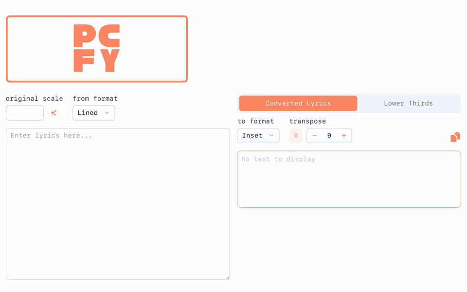

# Proclaimify



[](https://app.netlify.com/sites/subtle-sunburst-a96579/deploys)

Proclaimify gets a song ready for Sunday, even if you're not a musician:

- It converts chord sheets with chords above the lyrics into the inline
  `[G]Amazing grace` format that Faithlife's Proclaim needs.
- It suggests the song's key.
- It transposes the song, or shows the chords as numbers.
- It splits the lyrics into lower thirds for the livestream.


## Development

Look at the [Nuxt 3 documentation](https://nuxt.com/docs/getting-started/introduction) to learn more.

## Setup

Make sure to install the dependencies:

```bash
# yarn
yarn install

# npm
npm install

# pnpm
pnpm install
```

## Development Server

Start the development server on http://localhost:3000

```bash
npm run dev
```

## Production

Build the application for production:

```bash
npm run build
```

Locally preview production build:

```bash
npm run preview
```

Check out the [deployment documentation](https://nuxt.com/docs/getting-started/deployment) for more information.
